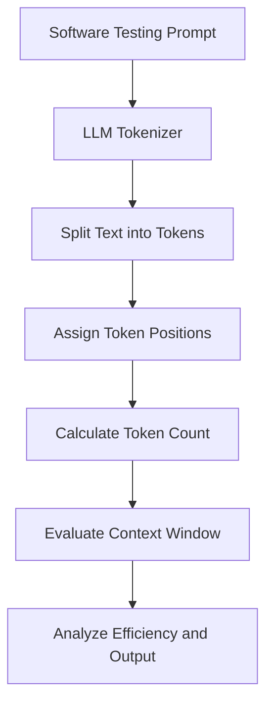
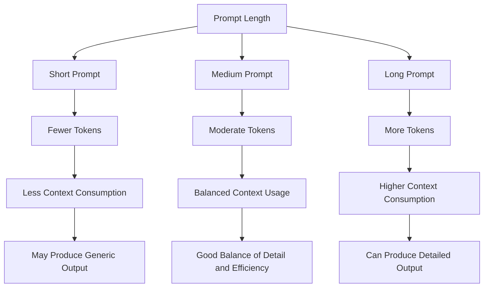

# HO-1.1.2 — Tokenization and Token Count Evaluation

**Certification:** ISTQB CT-GenAI  
**Objective:** HO-1.1.2 (H1)  
**Focus:** Tokenization | Token Count | Context Window | Efficiency

---

## 1. Objective

- Understand how an LLM breaks text into tokens.
- Examine words, subwords, punctuation and spaces.
- Compare short, medium and long software-testing prompts.
- Evaluate token usage, context-window consumption and efficiency.

## 2. Tokenization Workflow



## 3. Part A — Tokenization

**Sample Input:**

```text
Login failed! Check userName, password, and HTTP 401 response.
```

### Token Breakdown

| Token Position | Token |
|---|---|
| T01 | `Login` |
| T02 | `␠failed` |
| T03 | `!` |
| T04 | `␠Check` |
| T05 | `␠user` |
| T06 | `Name` |
| T07 | `,` |
| T08 | `␠password` |
| T09 | `,` |
| T10 | `␠and` |
| T11 | `␠HTTP` |
| T12 | `␠401` |
| T13 | `␠response` |
| T14 | `.` |
| **Total** | **14 illustrative token pieces** |

**Observations:**

- `userName` may be divided into multiple tokens.
- Punctuation can become separate tokens.
- Spaces can be included in token pieces.
- Numbers and technical terms may have different token boundaries.
- Tokenization depends on the tokenizer and model encoding.

> Note: T01, T02, etc. are token sequence numbers, not actual vocabulary IDs. This is an illustrative breakdown. Actual token pieces and numeric IDs must be checked using the selected model's tokenizer.

---

## 4. Part B — Token Count Evaluation

### Experiment 1 — Short Prompt

**Prompt:**

```text
Test the login feature. Check valid and invalid credentials, empty fields, and the error message.
```

**Word Identification:**

| Word ID | Word |
|---|---|
| W01 | Test |
| W02 | the |
| W03 | login |
| W04 | feature. |
| W05 | Check |
| W06 | valid |
| W07 | and |
| W08 | invalid |
| W09 | credentials, |
| W10 | empty |
| W11 | fields, |
| W12 | and |
| W13 | the |
| W14 | error |
| W15 | message. |

**Evaluation:**

| Metric | Result |
|---|---:|
| Word Count | 15 |
| Estimated Token Count | ~24 |

**Analysis:**

- Prompt length: Short.
- Context usage: Low.
- Response: Likely to produce basic test ideas.
- Limitation: May miss boundary cases and detailed requirements.
- Efficiency: Less input processing; leaves more context capacity.

**Testing Observation:** Suitable for brainstorming, but insufficient when detailed test coverage is expected.

---

### Experiment 2 — Medium Prompt

**Prompt:**

```text
Act as a software tester. Create login test cases for valid credentials, an incorrect password, an unknown username, empty fields, and leading or trailing spaces. For each test case, include a title, test steps, test data, and expected result. Cover positive and negative scenarios.
```

**Word Identification:**

| Word ID | Word |
|---|---|
| W01 | Act |
| W02 | as |
| W03 | a |
| W04 | software |
| W05 | tester. |
| W06 | Create |
| W07 | login |
| W08 | test |
| W09 | cases |
| W10 | for |
| W11 | valid |
| W12 | credentials, |
| W13 | an |
| W14 | incorrect |
| W15 | password, |
| W16 | an |
| W17 | unknown |
| W18 | username, |
| W19 | empty |
| W20 | fields, |
| W21 | and |
| W22 | leading |
| W23 | or |
| W24 | trailing |
| W25 | spaces. |
| W26 | For |
| W27 | each |
| W28 | test |
| W29 | case, |
| W30 | include |
| W31 | a |
| W32 | title, |
| W33 | test |
| W34 | steps, |
| W35 | test |
| W36 | data, |
| W37 | and |
| W38 | expected |
| W39 | result. |
| W40 | Cover |
| W41 | positive |
| W42 | and |
| W43 | negative |
| W44 | scenarios. |

**Evaluation:**

| Metric | Result |
|---|---:|
| Word Count | 44 |
| Estimated Token Count | ~70 |

**Analysis:**

- Prompt length: Medium.
- Context usage: Moderate.
- Response: More structured test cases.
- Coverage: Includes positive and negative scenarios.
- Efficiency: Good balance between prompt detail and token consumption.

**Testing Observation:** Provides sufficient instructions for generating practical functional test cases without unnecessary details.

---

### Experiment 3 — Long Prompt

**Prompt:**

```text
Act as a senior QA engineer. Create functional test cases for a web application's login feature. The form contains a username field, a password field, a Login button, and a Forgot Password link. Successful login must navigate to the dashboard. Invalid credentials must display a clear error without revealing whether the username or password was incorrect. Both fields are mandatory. Reject whitespace-only values; trim leading and trailing spaces from the username but do not change the password. Cover valid credentials, incorrect password, unknown username, empty fields, whitespace-only input, username spaces, password case sensitivity, repeated failed attempts, Enter-key submission, password masking, and accessible error messages. For each test case, provide an ID, title, priority, preconditions, test data, numbered steps, and expected result. Group positive, negative, boundary, usability, and accessibility scenarios. Do not invent requirements; list assumptions and questions for the product owner.
```

**Word Identification:**

| Word ID | Word | Word ID | Word |
|---|---|---|---|
| W01 | Act | W02 | as |
| W03 | a | W04 | senior |
| W05 | QA | W06 | engineer. |
| W07 | Create | W08 | functional |
| W09 | test | W10 | cases |
| W11 | for | W12 | a |
| W13 | web | W14 | application's |
| W15 | login | W16 | feature. |
| W17 | The | W18 | form |
| W19 | contains | W20 | a |
| W21 | username | W22 | field, |
| W23 | a | W24 | password |
| W25 | field, | W26 | a |
| W27 | Login | W28 | button, |
| W29 | and | W30 | a |
| W31 | Forgot | W32 | Password |
| W33 | link. | W34 | Successful |
| W35 | login | W36 | must |
| W37 | navigate | W38 | to |
| W39 | the | W40 | dashboard. |
| W41 | Invalid | W42 | credentials |
| W43 | must | W44 | display |
| W45 | a | W46 | clear |
| W47 | error | W48 | without |
| W49 | revealing | W50 | whether |
| W51 | the | W52 | username |
| W53 | or | W54 | password |
| W55 | was | W56 | incorrect. |
| W57 | Both | W58 | fields |
| W59 | are | W60 | mandatory. |
| W61 | Reject | W62 | whitespace-only |
| W63 | values; | W64 | trim |
| W65 | leading | W66 | and |
| W67 | trailing | W68 | spaces |
| W69 | from | W70 | the |
| W71 | username | W72 | but |
| W73 | do | W74 | not |
| W75 | change | W76 | the |
| W77 | password. | W78 | Cover |
| W79 | valid | W80 | credentials, |
| W81 | incorrect | W82 | password, |
| W83 | unknown | W84 | username, |
| W85 | empty | W86 | fields, |
| W87 | whitespace-only | W88 | input, |
| W89 | username | W90 | spaces, |
| W91 | password | W92 | case |
| W93 | sensitivity, | W94 | repeated |
| W95 | failed | W96 | attempts, |
| W97 | Enter-key | W98 | submission, |
| W99 | password | W100 | masking, |
| W101 | and | W102 | accessible |
| W103 | error | W104 | messages. |
| W105 | For | W106 | each |
| W107 | test | W108 | case, |
| W109 | provide | W110 | an |
| W111 | ID, | W112 | title, |
| W113 | priority, | W114 | preconditions, |
| W115 | test | W116 | data, |
| W117 | numbered | W118 | steps, |
| W119 | and | W120 | expected |
| W121 | result. | W122 | Group |
| W123 | positive, | W124 | negative, |
| W125 | boundary, | W126 | usability, |
| W127 | and | W128 | accessibility |
| W129 | scenarios. | W130 | Do |
| W131 | not | W132 | invent |
| W133 | requirements; | W134 | list |
| W135 | assumptions | W136 | and |
| W137 | questions | W138 | for |
| W139 | the | W140 | product |
| W141 | owner. | | |

**Evaluation:**

| Metric | Result |
|---|---:|
| Word Count | 141 |
| Estimated Token Count | ~253 |

**Analysis:**

- Prompt length: Long.
- Context usage: High compared with the short prompt.
- Response: More detailed and structured test cases.
- Coverage: Includes functional, negative, boundary, usability and accessibility scenarios.
- Efficiency: More input tokens; potentially higher processing cost and latency.
- Limitation: Unnecessary or conflicting instructions can reduce clarity.

**Testing Observation:** Useful for complex testing tasks when detailed requirements and expected output structure are important.

---

## 5. Comparison of Results

| Measurement | Short | Medium | Long |
|---|---:|---:|---:|
| Word Count | 15 | 44 | 141 |
| Estimated Tokens | ~24 | ~70 | ~253 |
| Context Usage | Low | Moderate | High |
| Instruction Detail | Low | Medium | High |
| Test Coverage | Basic | Good | Detailed |
| Output Structure | Limited | Structured | Highly structured |
| Efficiency | High | Balanced | Depends on relevance |

### Visual Comparison



---

## 6. Impact of Token Count on LLM Performance

| Factor | Short Prompt | Long Prompt |
|---|---|---|
| Processing | Usually less input processing | Usually more input processing |
| Context Window | Uses fewer tokens | Uses more tokens |
| Response Detail | May be generic | Can be more comprehensive |
| Test Coverage | May miss edge cases | Can include more scenarios |
| API Cost | Usually lower | Can be higher |
| Response Time | Often shorter | May be longer |
| Output Quality | Depends on clarity | Depends on relevance and clarity |

### Context Window Illustration

```text
             LLM CONTEXT WINDOW
    ┌─────────────────────────────────┐
    │                                 │
    │       Available Capacity        │
    │                                 │
    └─────────────────────────────────┘

SHORT PROMPT
    ┌─────────────────────────────────┐
    │ Input Tokens │ Remaining Space  │
    └─────────────────────────────────┘

LONG PROMPT
    ┌─────────────────────────────────┐
    │         Input Tokens            │
    │         Remaining Space         │
    └─────────────────────────────────┘
```

**Important considerations:**

- Context window includes more than the user's prompt.
- System instructions, conversation history, attached content and generated output may also consume tokens.
- Exceeding the context limit may require reducing or restructuring the input.
- A longer prompt does not automatically guarantee a better answer.

---

## 7. Key Findings as a Software Tester

1. Tokenization: A word can be represented by one or multiple tokens.
2. Punctuation: Special characters and spaces affect token boundaries.
3. Short prompts: Save tokens; may lack testing requirements.
4. Long prompts: Provide more context; consume more of the context window.
5. Efficiency: Remove repetition without removing important test conditions.
6. Quality: Clear requirements and relevant context matter more than prompt length alone.

### Best Practice

```text
Clear Testing Objective
          +
Relevant Requirements
          +
Expected Test Coverage
          +
Defined Output Format
          ↓
  Effective LLM Prompt
          ↓
  Better Testing Results
```

## 8. Conclusion

| Prompt Type | Conclusion |
|---|---|
| Short | Token-efficient; may produce generic test cases. |
| Medium | Practical balance between context and detail. |
| Long | Useful for complex scenarios; requires more tokens. |

**Final takeaway:** As a software tester, aim for the minimum sufficient prompt; retain all essential requirements, acceptance criteria and edge cases while avoiding unnecessary instructions.

---

