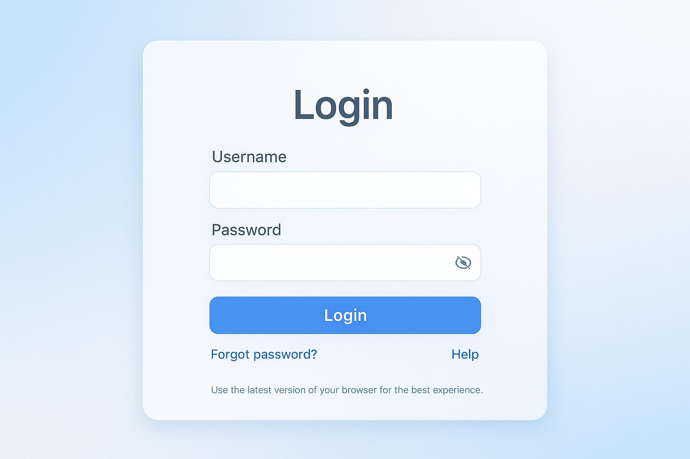

# HO-1.1.4 (H1): Using a Multimodal LLM for Software Testing

## Objective

Write and execute a prompt addressing a software testing task using a multimodal Large Language Model (LLM) that accepts both text and image inputs.

The objective is to understand how multimodal LLMs can analyse application screenshots against written requirements, identify UI issues, and support software testing activities.

## 1. Review the Inputs

### Test Scenario: Login Page UI Validation

**Application:** Sample Web Application  
**Testing Type:** UI Testing  
**Input Types:** Text and Image

### Text Input – Requirements

The login page should contain the following elements:

1. A username input field.
2. A password input field.
3. A Login button.
4. A Forgot Password link.

### Image Input

A screenshot of the application's login page is provided as visual input to the multimodal LLM.




## 2. Write the Prompt

The following prompt is provided to the multimodal LLM along with the login page screenshot.

### Prompt

```text
Act as an experienced QA engineer.

Analyse the attached login page screenshot against the following
requirements:

1. A username field must be displayed.
2. A password field must be displayed.
3. A Login button must be available.
4. A Forgot Password link must be displayed.

Perform the following tasks:

- Identify which requirements are satisfied.
- Identify missing or incorrectly implemented UI elements.
- Highlight any visible UI inconsistencies.
- Suggest relevant test scenarios.

Present your findings in a table with the following columns:
Requirement, Actual Observation, Status (Pass/Fail), and Remarks.

Important:
Do not assume functionality based on appearance alone.
Clearly distinguish between visual observations and
behaviour that requires execution testing.
```

## 3. Execute the Prompt and Analyse the Result

Submit the written requirements and login page screenshot together to a multimodal LLM.

### Sample LLM Output

| Requirement | Actual Observation | Status | Remarks |
|---|---|---|---|
| Username field | Username input field is visible. | Pass | Visual element identified. |
| Password field | Password input field is visible. | Pass | Password masking cannot be confirmed from a static screenshot alone. |
| Login button | Login button is displayed. | Pass | Button visibility confirmed. |
| Forgot Password link | Forgot Password link is visible. | Pass | Link visibility confirmed. |

**Note:** The above is an illustrative expected output. Replace it with the actual LLM response obtained during execution.

### Additional Test Scenarios Suggested

1. Verify that users can enter a valid username.
2. Verify that the password field masks entered characters.
3. Verify that the Login button responds when clicked.
4. Verify login behaviour with valid credentials.
5. Verify login behaviour with invalid credentials.
6. Verify the Forgot Password navigation.
7. Verify validation messages when mandatory fields are empty.

## 4. Verify the Actual Result

The LLM-generated observations should be compared against the original screenshot and application.

| Verification Activity | Expected Result |
|---|---|
| Username field identification | Correctly identified. |
| Password field identification | Correctly identified. |
| Login button identification | Correctly identified. |
| Forgot Password link identification | Correctly identified. |
| UI inconsistency detection | Findings should match visible evidence. |
| Functional behaviour | Must be verified through actual execution testing. |

### Verification Approach

- Compare each LLM observation with the original screenshot.
- Check whether any UI elements were missed or incorrectly identified.
- Validate suggested test scenarios against the application requirements.
- Execute functional test scenarios separately to confirm actual behaviour.
- Record any incorrect assumptions or hallucinations made by the LLM.

## 5. Benefits of Using Multimodal LLMs

- **Combined Input Analysis:** Analyses textual requirements and application screenshots together.
- **Faster Test Analysis:** Helps identify missing UI elements and inconsistencies.
- **Test Scenario Generation:** Suggests additional test scenarios based on visual information.
- **Reduced Manual Effort:** Supports initial UI analysis and test design activities.
- **Improved Test Coverage:** Helps QA engineers identify potential scenarios they may have overlooked.

## 6. Challenges and Limitations

- **Image Quality:** Blurry or low-resolution screenshots may lead to incorrect observations.
- **Hallucinations:** The LLM may identify elements that are not actually present.
- **Limited Functional Validation:** A screenshot cannot confirm whether buttons, links, or input fields work correctly.
- **Context Dependency:** Incomplete or unclear requirements may produce misleading results.
- **Human Verification:** LLM-generated findings must be independently validated by a QA engineer.

## 7. Conclusion

Multimodal LLMs can support software testing by analysing both textual requirements and application screenshots. They can help QA engineers identify UI elements, detect potential inconsistencies, and generate test scenarios more efficiently.

However, the generated results should not be accepted without verification. Human review and actual application execution remain essential to ensure accuracy and reliability.

**Key Learning:** Multimodal LLMs extend traditional text-based AI capabilities by combining visual and textual understanding, making them useful assistants for UI testing and test analysis.
