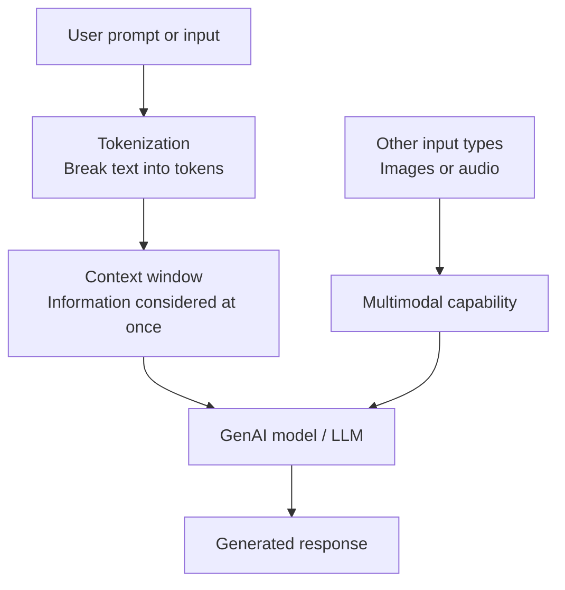

# 1.1.1 Generative AI and Key Concepts

## 1. What is Generative AI?

**Generative AI (GenAI)** is a branch of **Artificial Intelligence (AI)** that uses large, pre-trained models to generate new output.

### ✨ What can GenAI generate?

| Output type | Examples |
|---|---|
| 📝 Text | Explanations, summaries, and documentation |
| 🖼️ Images | Images created from prompts |
| 💻 Code | Code snippets and test scripts |

**Examples of GenAI tools:** ChatGPT and Google Gemini.

## 2. What is a Large Language Model (LLM)?

A **Large Language Model (LLM)** is a type of GenAI model pre-trained on large text datasets. It uses the context of the input prompt to produce a relevant response.

> **Remember:** GenAI is the broader concept; an LLM is a type of model focused on working with language.

## 3. Three Key GenAI Concepts

| Concept | Meaning | Simple way to remember |
|---|---|---|
| 🔤 **Tokenization** | Breaking text into smaller units called *tokens* so it can be processed by the model. | Text → tokens |
| 🪟 **Context window** | The amount of information a model can consider at one time when generating a response. | The model’s current working context |
| 🧩 **Multimodal models** | Models that can process more than one type of data, such as text, images, and audio. | Multiple data types in one model |

### 🔄 How the concepts fit together

## 4. How LLMs Support Software Testing

LLMs can assist testers throughout test analysis, test design, execution support, and documentation.

| No. | Testing task | How an LLM can help |
|---:|---|---|
| 1 | ✅ **Review and improve Acceptance Criteria (AC)** | Check acceptance criteria for clarity, completeness, ambiguity, and testability. |
| 2 | 🧪 **Generate test cases and test scripts** | Suggest test scenarios, test cases, and scripts from requirements or acceptance criteria. |
| 3 | 🐞 **Identify potential defects** | Highlight possible problems, missing conditions, or inconsistencies in requirements or code. |
| 4 | 🔍 **Analyze defect patterns** | Help group and summarize defect reports to identify recurring patterns. |
| 5 | 🧬 **Generate synthetic test data** | Create artificial test data for testing without needing to use real production data. |
| 6 | 📄 **Support documentation generation** | Draft or improve test plans, test cases, test summaries, and other testing documentation. |

> **Testing reminder:** LLM outputs are suggestions. Review and validate generated test cases, scripts, data, and documentation before using them.

## 5. Quick Revision

- **GenAI** is a branch of AI that generates outputs such as text, images, and code using large pre-trained models.
- **LLMs** are GenAI models pre-trained on large text datasets and used to generate responses based on a prompt and its context.
- The three key concepts are **tokenization**, **context window**, and **multimodal models**.
- LLMs can support acceptance-criteria review, test generation, potential-defect identification, defect-pattern analysis, synthetic test-data generation, and documentation.

## 6. Self-Check Questions

1. What is Generative AI, and name two examples of GenAI tools.
2. What is an LLM?
3. What is the difference between tokenization and a context window?
4. What makes a model multimodal?
5. Name three ways an LLM can support software testing.

Show answers

1. GenAI is a branch of AI that uses large, pre-trained models to generate outputs such as text, images, and code. Examples include ChatGPT and Gemini.
2. An LLM is a GenAI model pre-trained on large text datasets that uses the prompt’s context to generate a relevant response.
3. Tokenization breaks text into smaller units for processing; the context window is the amount of information the model can consider at one time.
4. A multimodal model can process multiple data types, such as text, images, and audio.
5. Examples include reviewing acceptance criteria, generating test cases or scripts, identifying potential defects, analyzing defect patterns, generating synthetic test data, and drafting documentation.

